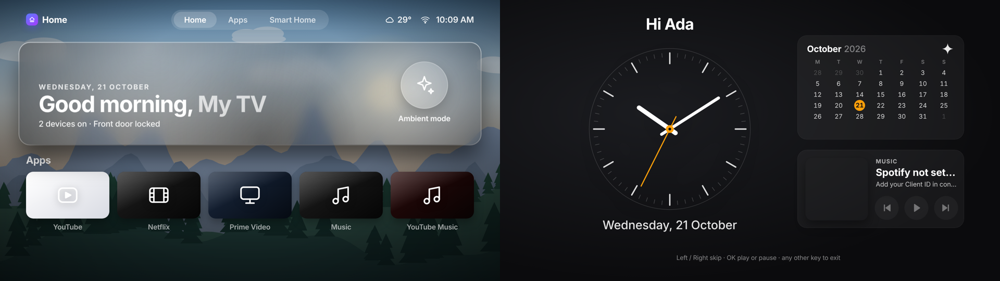

# VIDAA Home Launcher

An Apple TV-style home screen for Hisense VIDAA TVs, and any smart TV with a web browser. It's one HTML page: no framework, no build step, no app store.



## Features

- Greeting with your TV's name, over a nature scene that follows the time of day
- App tiles with tvOS-style focus effects: zoom, 3D tilt and shine
- A preview panel for each app when you focus its tile
- Live weather from Open-Meteo (free, no key)
- Spotify now playing, plus play, pause and skip (optional)
- A Smart Home tab for lights, AC, locks, gate and curtains, with scenes (demo mode, or real devices through Home Assistant)
- A minimal clock screen when idle: analog clock, greeting, month calendar, music controls
- Works with arrow keys and with the pointer that VIDAA's browser uses
- A built-in diagnostic screen that checks what your TV's browser supports

## Why a web page?

VIDAA is Hisense's own operating system. It doesn't let you replace the home screen or install your own apps, and apps only come from Hisense's curated store. VIDAA's store apps are themselves HTML5 web apps, though, so a web page opened in the TV browser behaves almost like one.

## Quick start

1. Download this repository and unzip it.
2. Add your app logos to `logos/clean/` (see `LOGOS.md`). The tiles work without them.
3. Edit `config.js`: your TV's name, your name and your city.
4. Host the folder. The easiest free option is to drag it onto [app.netlify.com/drop](https://app.netlify.com/drop). You get an address like `https://your-site.netlify.app`.
5. Open that address in your TV's browser and bookmark it.

To try it on a computer first, open `index.html` in Chrome. Spotify login only works from an https address.

## Using it

| Key | Action |
| --- | --- |
| Arrows | Move between tiles |
| OK / Enter | Open the app or switch the device |
| Back | Return to the Home tab |
| Any key on the clock screen | Return to the home screen (Left and Right skip tracks, OK plays or pauses) |
| Click "Home" 3 times, press D or the red button | Open the diagnostic screen |

On VIDAA the browser remote moves a pointer: point at a tile and press OK.

## Apps and streaming services

The launcher doesn't play video itself. Each tile opens the service's website in the TV's browser, and you watch there.

| App | Tile opens | Live data in the preview panel |
| --- | --- | --- |
| YouTube | `youtube.com/tv`, the TV-sized site | No (sample title) |
| Netflix | `netflix.com` | No (sample title) |
| Prime Video | `primevideo.com` | No (sample title) |
| Showmax | `showmax.com` | No (sample title) |
| Spotify | `open.spotify.com` | Yes, with a login (see below) |
| YouTube Music | `music.youtube.com` | No |
| Weather | A forecast site | Yes, free (Open-Meteo) |

### Using Netflix and the other video apps

1. Press OK on the tile. The service's website opens.
2. Sign in the first time. The TV browser remembers you after that.
3. Pick something and play it.
4. Press Back, or open your bookmark, to return to the launcher.

Things to know:

- **Video may not play in the TV browser.** Netflix, Prime Video and Showmax use protected video, and many TV browsers are too old or restricted to play it. If it doesn't play, use that service's own app from the TV's normal home screen. The launcher can't start those apps.
- **Preview panels show sample titles** for Netflix, YouTube, Prime Video and Showmax. These services don't let outside apps read your watch history, so no "continue watching" data can be shown. Edit the `RECENT` list in `index.html` if you want your own text.
- **Only Spotify and the weather can show live data**, because only they offer a public API.
- **You need your own accounts.** Netflix, Prime Video and Showmax need a subscription, and the launcher doesn't give access to any paid content.

### Adding or changing an app

Edit the `APPS` list near the top of the script in `index.html`. Each entry is a name, a link and a logo:

```javascript
{ name: "Netflix", url: "https://www.netflix.com", icon: "film", g: "linear-gradient(145deg,#1f1f1f,#050505)", img: "logos/clean/netflix.png" },
```

The first five apps appear on the Home tab and the rest on the Apps tab. Any website works, so you can add Twitch, a news site or your own dashboard.

## Spotify

1. Log in at [developer.spotify.com/dashboard](https://developer.spotify.com/dashboard) and create an app with **Web API** ticked.
2. Add your page's exact address as a Redirect URI, for example `https://your-site.netlify.app/index.html`.
3. Put the Client ID (and that address as `redirectUri`) in `config.js`, then upload again.
4. On each screen, focus the Music tile and press OK once to log in.

It uses the PKCE login flow, so no secret is stored. Spotify requires Premium for apps in development mode, and allows up to 5 users per app. The music controls steer whichever Spotify app is currently playing.

## Smart home

The Smart Home tab shows tiles for lights, a fan, an AC, a door lock, a gate, curtains and cameras, plus **All Off**, **Movie Mode** and **Good Night** scenes. By default it's a **demo**: the tiles switch on screen but control nothing, and the tab says so.

To control real devices, the launcher can talk to [Home Assistant](https://www.home-assistant.io/), a free hub that supports lights, locks, plugs, ACs and covers from many brands. It's the only smart-home system supported so far.

You'll need:

- A Home Assistant installation on your home network
- Your devices added to Home Assistant
- A **long-lived access token**: in Home Assistant, open your profile, then Security, then Long-lived access tokens, then Create token

Then fill in the `homeAssistant` block in `config.js`:

```javascript
homeAssistant: {
  url: "http://homeassistant.local:8123",
  token: "your long-lived access token",
  entities: {
    lr: "light.living_room",   // Ceiling Lights
    bl: "light.bedside",       // Bedside Lamps
    fan: "fan.ceiling_fan",
    ac: "climate.bedroom",
    door: "lock.front_door",
    gate: "cover.main_gate",
    cur: "cover.living_room_curtains",
    cam: "switch.cameras"
  }
}
```

The names on the right are your devices' entity IDs, which you can find in Home Assistant under Settings, then Devices and entities. Leave out any you don't have.

Important:

- **Never publish a copy that contains your token.** Anyone who has it can control your home. Keep the filled-in version on your own network only, for example in Home Assistant's `config/www` folder, and open it at `http://homeassistant.local:8123/local/...`.
- **A page hosted on https can't reach an http Home Assistant.** Browsers block that, so a Netlify copy can't control devices on your home network. Serve the page from Home Assistant instead.
- The tiles update from Home Assistant every 20 seconds.

### Ask Claude to set it up for you

You don't need to write this yourself. Open Claude, attach this project's `index.html` and `config.js`, and ask something like:

> I use [Home Assistant / Tuya / Google Home / SmartThings / a brand app]. Help me connect my [lights, AC, door lock] to this launcher's Smart Home tab. Walk me through it one step at a time.

Claude can:

- Explain how to set up Home Assistant and find your entity IDs
- Fill in the `homeAssistant` block for you from a list of your devices
- Rename, add or remove tiles in the `DEVICES` list in `index.html`
- Add support for another system with an API, such as Philips Hue or a Tuya hub. That takes custom code, so ask Claude to write it and test it on your own devices.

If you use a different smart-home app today, tell Claude which one, since some can be added to Home Assistant first.

## Compatibility

Tested on a Hisense VIDAA TV with an Opera-based browser on Chromium 84 (1280 x 720 at 1.5x). The code avoids newer JavaScript and CSS on purpose. Use the diagnostic screen to check your TV.

## Trademarks

Apple TV and tvOS are trademarks of Apple. Hisense and VIDAA are trademarks of their owners. Netflix, YouTube, Prime Video, Spotify and Showmax are trademarks of their owners. This project isn't affiliated with any of them and ships no brand logos.

## License

MIT. See `LICENSE`. Built with help from Claude.
